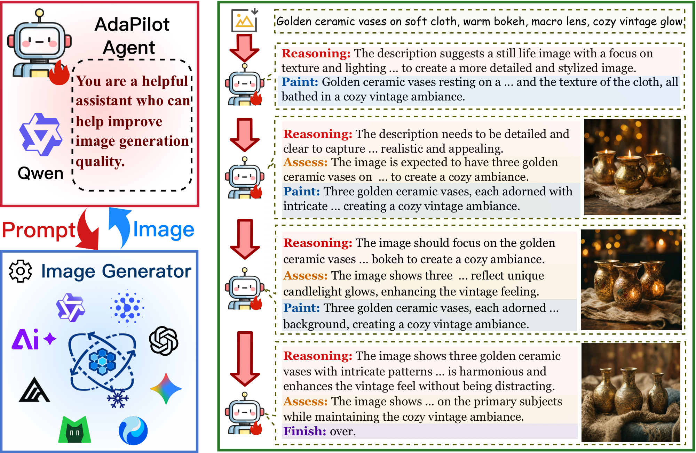
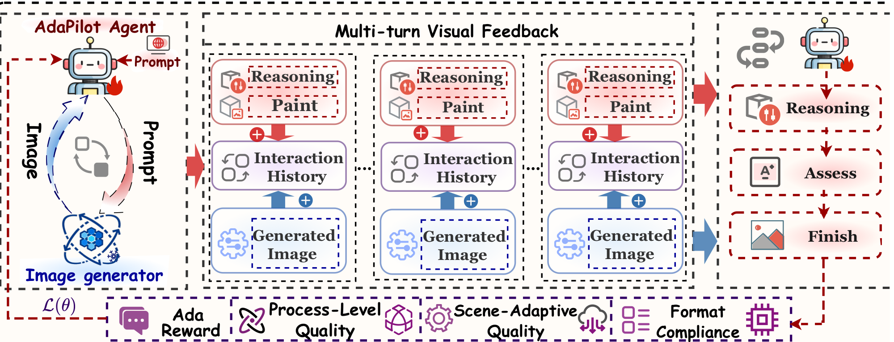
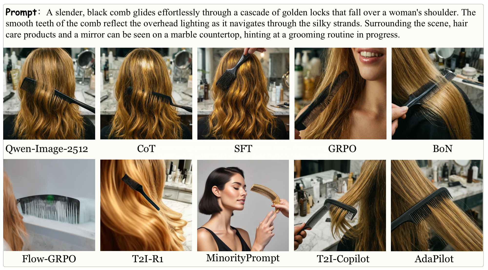
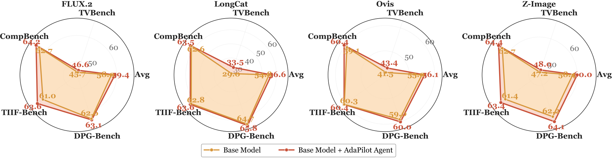
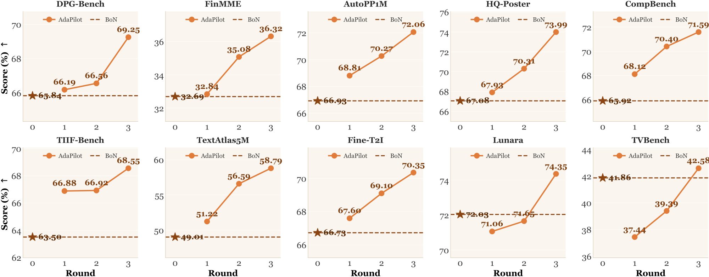

<div align="center">

### **AdaPilot**: Towards Scene-Adaptive Policy Learning for Cross-Generator Text-to-Image Quality Optimization

[📄 Paper](https://arxiv.org/abs/2609.29517) | [🏠 Homepage](https://qwenqking.github.io/adapilot-release/) | [🚀 Quick Start](#quick-start) | [💬 Contact](mailto:wenjinliu23@outlook.com)

</div>

---

## Overview

<div align="center">
  
</div>

**AdaPilot** is a scene-adaptive policy learning framework for cross-generator text-to-image quality optimization. It trains a multimodal large language model (MLLM) agent via end-to-end reinforcement learning to iteratively improve image generation quality through multi-turn visual feedback — with the image generator kept **fully frozen**.

Unlike prior methods that are tightly coupled with a specific generator, AdaPilot decouples the policy from generator internals and learns to **zero-shot transfer** across unseen generators without any retraining.

<div align="center">
  
</div>

**Three core mechanisms:**

- **Adaptive Multi-Turn Generation.** The agent (Qwen2.5-VL-7B) iteratively reasons, generates optimized prompts, assesses the returned image, and decides whether to refine or terminate — forming a closed-loop visual feedback MDP.
- **AdaReward (Scene-Adaptive Quality Reward).** Different scene types (poster, e-commerce, text-rich, etc.) activate different metric subsets (CLIP-T, HPS, Aesthetic, GDino, OCR) with renormalized weights, plus a process-level monotonic improvement constraint across turns.
- **Cross-Generator Policy Decoupling.** The policy conditions only on visual observations, not generator internals, enabling zero-shot transfer to unseen generators (FLUX.2, LongCat, Ovis, Z-Image, GPT-Image-1, Gemini) at inference time.

---

## Experimental Results

**Qualitative comparison with baselines on a sample prompt:**

<div align="center">
  
</div>

**Cross-generator transfer — OOD datasets (4 unseen generators, radar charts):**

<div align="center">
  
</div>

**Monotonic quality improvement across interaction rounds on 10 benchmarks:**

<div align="center">
  
</div>

AdaPilot outperforms all baselines on **6 in-distribution** and **4 out-of-distribution** datasets, and a single policy zero-shot drives unseen generators while maintaining quality gains — with largest improvements on weaker generators.

---

## Quick Start

### Environment Setup

```bash
conda create -n adapilot python==3.12 -y
conda activate adapilot
```

Install verl (pinned commit used in our experiments):

```bash
pip3 install "verl[gpu,vllm] @ git+https://github.com/volcengine/verl.git@8e9e73723fd1cc729bedb3bbcf915060afbda91d"
```

Install flash-attn (pre-built wheel required — standard pip build often fails):

```bash
pip3 install flash-attn==2.7.4.post1
# If the above fails, download the matching wheel from:
# https://github.com/Dao-AILab/flash-attention/releases
```

Install remaining dependencies:

```bash
pip3 install -r adapilot_pip_freeze.txt
```

### Reward Model Deployment

AdaPilot's AdaReward relies on four self-hosted scoring servers. All servers expose a FastAPI HTTP interface and support dynamic batching. Deploy them before launching training or evaluation.

#### Model Downloads

| Server | Model | Source |
|---|---|---|
| CLIP | `openai/clip-vit-large-patch14` | [HuggingFace](https://huggingface.co/openai/clip-vit-large-patch14) |
| HPS v2.1 | `ViT-H-14` + `HPS_v2.1_compressed.pt` | [HuggingFace](https://huggingface.co/xswu/HPSv2) |
| GroundingDINO | `IDEA-Research/grounding-dino-base` | [HuggingFace](https://huggingface.co/IDEA-Research/grounding-dino-base) |
| GLM-OCR | `ZhipuAI/GLM-OCR` | [ModelScope](https://modelscope.cn/models/ZhipuAI/GLM-OCR) |

Download models to a local directory (e.g. `models/`) and set the paths via environment variables shown below.

#### CLIP Server — port 8030

Computes CLIP-T (text-image alignment) and CLIP-I (image-image similarity).

```bash
export CUDA_VISIBLE_DEVICES=7
export CLIP_MODEL_PATH=models/clip-vit-large-patch14   # local HF model dir
export CLIP_SERVER_PORT=8030
export CLIP_MAX_BATCH_SIZE=16
export CLIP_BATCH_TIMEOUT=0.05

cd rewardmodel && python clip_server.py
# or use the convenience script:
bash rewardmodel/start_clip_server.sh
```

Endpoints: `POST /clip_t` (image + caption → score), `POST /clip_i` (image\_gen + image\_gt → score), `GET /health`.

#### HPS v2.1 Server — port 8020

Computes human preference scores using HPSv2.1 (ViT-H-14).

```bash
export CUDA_VISIBLE_DEVICES=6
export HPS_MODEL_DIR=models/HPSv2                      # dir containing HPS_v2.1_compressed.pt
export HPS_SERVER_PORT=8020
export HPS_MAX_BATCH_SIZE=16
export HPS_BATCH_TIMEOUT=0.05

cd rewardmodel && python hps_server.py
# or:
bash rewardmodel/start_hps.sh
```

Endpoint: `POST /score` (image + prompt → raw\_score, normalized\_score), `GET /health`.

#### GroundingDINO Server — port 8010

Runs zero-shot object detection for entity grounding reward.

```bash
export CUDA_VISIBLE_DEVICES=5
export GDINO_MODEL_PATH=models/GroundingDINO           # local HF model dir

cd rewardmodel && uvicorn gdino_server:app --host 0.0.0.0 --port 8010
# or:
bash rewardmodel/start_gdino.sh
```

Endpoint: `POST /detect` (image + queries → boxes, scores, labels), `GET /health`.

#### GLM-OCR Server — port 4512

Provides OCR-based text rendering accuracy reward via GLM-OCR. Also exposes an OpenAI-compatible `/v1/chat/completions` endpoint so it can be called through `GLM_OCR_API_BASE`.

```bash
export CUDA_VISIBLE_DEVICES=4
export GLM_OCR_MODEL_PATH=models/GLM-OCR              # local ModelScope model dir
export GLM_OCR_SERVER_PORT=4512

bash rewardmodel/glm-ocr.sh
# or equivalently:
CUDA_DEVICE=4 PORT=4512 bash rewardmodel/glm-ocr.sh
```

Endpoint: `POST /ocr` (image\_base64 + prompt → result), `POST /v1/chat/completions` (OpenAI-compatible), `GET /health`.

#### Image Generation Server

AdaPilot calls the image generator via an OpenAI-compatible `POST /v1/images/generations` endpoint. We use [vllm-omni](https://github.com/vllm-project/vllm-omni) to serve all image generation models. **This requires a separate conda environment** from the main AdaPilot environment.

**Install vllm-omni:**

```bash
conda create -n vllm-omni python=3.12 -y
conda activate vllm-omni
pip install vllm==0.20.0          # install vLLM base first
pip install vllm-omni             # then the omni extension
```

**Supported models and launch scripts** (see `T2I-model/`):

The following models are served via **vllm-omni**:

| Model | Script | GPUs | Port |
|---|---|---|---|
| Qwen-Image-2512 (training generator) | `T2I-model/qwen-image.sh` | 4 | 4011 |
| FLUX.2-klein-base-9B | `T2I-model/flux-9b.sh` | 4 | 4011 |
| LongCat-Image | `T2I-model/longcat-image.sh` | 8 | 4011 |
| Z-Image | `T2I-model/z-image.sh` | 2 | 4011 |
| Ovis-Image-7B | `T2I-model/ovis.sh` | 8 | 4011 |
| GLM-Image | `T2I-model/glm.sh` | 4 | 1070 |

**ERNIE-Image** is served via **[SGLang](https://github.com/sgl-project/sglang)** in a separate environment:

```bash
conda create -n ernie-sglang python=3.12 -y
conda activate ernie-sglang
pip install sglang[all]
```

Then launch:

```bash
conda activate ernie-sglang
bash T2I-model/start_ernie.sh
```

Example (Qwen-Image-2512, training generator):

```bash
conda activate vllm-omni
export CUDA_VISIBLE_DEVICES=0,1,2,3
vllm serve ./Qwen-Image-2512 \
  --omni \
  --port 4011 \
  --tensor-parallel-size 4 \
  --gpu-memory-utilization 0.8 \
  --dtype bfloat16 \
  --served-model-name Qwen-Image
```

Once the server is running, set `IMAGE_GEN_BASE_URL` to point to it:

```bash
export IMAGE_GEN_BASE_URL=http://<server-ip>:4011
export IMAGE_GEN_SIZE="1024x1024"
export IMAGE_GEN_STEPS=50
export IMAGE_GEN_GUIDANCE=4.5
export IMAGE_GEN_TIMEOUT=300
export IMAGE_GEN_MAX_CONCURRENT=4
```

#### Environment Variables for Training / Evaluation

Once all servers are running, point AdaPilot to them:

| Variable | Description |
|---|---|
| `IMAGE_GEN_BASE_URL` | Image generation API endpoint (OpenAI-compatible) |
| `CLIP_SERVER_URL` | e.g. `http://localhost:8030` |
| `HPS_SERVER_URL` | e.g. `http://localhost:8020` |
| `GDINO_SERVER_URL` | e.g. `http://localhost:8010` |
| `GLM_OCR_API_BASE` | e.g. `http://localhost:4512` |
| `VLM_API_BASE` / `VLM_MODEL` | VLM judge for aesthetic scoring and entity extraction — set to an OpenAI-compatible endpoint serving **Qwen2.5-VL-72B-Instruct** (used during training only) |

> **Training-time VLM judge.** Aesthetic quality assessment and entity extraction in AdaReward call an external VLM API. During our experiments we used `Qwen2.5-VL-72B-Instruct` served via a vLLM OpenAI-compatible endpoint. Set `VLM_MODEL=Qwen2.5-VL-72B-Instruct` and point `VLM_API_BASE` to your server. This dependency is only required for training (reward computation); inference does not need it.

Servers can also be replaced by passing the local model path instead of a URL (e.g. `CLIP_MODEL_PATH` instead of `CLIP_SERVER_URL`), in which case the reward code loads the model in-process.

### Dataset

The mixed training and validation sets are included in `train-data/`:

```
train-data/
├── train.parquet    # training split
└── val.parquet      # validation split
```

These files are used directly by the training script via:

```bash
export TRAIN_DATA_PATH=train-data/train.parquet
export VAL_DATA_PATH=train-data/val.parquet
```

The dataset covers diverse scene types: compositional generation, e-commerce product imagery, poster design, aesthetic generation, and text-rich synthesis — matching the six in-distribution benchmarks evaluated in the paper.

### Training

```bash
export BASE_MODEL=/path/to/Qwen2.5-VL-7B-Instruct
export IMAGE_GEN_BASE_URL=http://your-image-gen-server
# ... set other service URLs above

bash adapilot/scripts/train_adapilot.sh
```

The script starts a Ray cluster, then runs GRPO training via `adapilot.trainer.multimodal.main_ppo`.

**Key hyperparameters** (configurable in `train_adapilot.sh`):

| Parameter | Default | Description |
|---|---|---|
| `data.train_batch_size` | 32 | Global batch size |
| `data.max_prompt_length` | 8192 | Max prompt tokens |
| `actor_rollout_ref.rollout.n` | 4 | Rollout samples per prompt |
| `actor_rollout_ref.rollout.max_gen_round` | 6 | Max multi-turn rounds |
| `actor_rollout_ref.actor.optim.lr` | 2e-6 | Learning rate |
| `trainer.n_gpus_per_node` | 4 | GPUs per node |
| `trainer.total_epochs` | 2 | Training epochs |

Our experiments used 2 servers × 8 NVIDIA H100 (80GB) GPUs.

### Inference

Two inference scripts are provided. Both read test datasets from `test-data/` by default and save results under `results/`.

#### Option A — vLLM multi-dataset inference (recommended)

`inference_vllm.sh` scans all subdirectories in `DATA_ROOT` for `*_test.parquet` files and runs inference on each dataset in sequence. It starts its own Ray cluster internally.

```bash
export BASE_MODEL=/path/to/Qwen2.5-VL-7B-Instruct
export CKPT_DIR=/path/to/checkpoints/adapilot/adapilot_train
export IMAGE_GEN_BASE_URL=http://<image-gen-server>:<port>

bash adapilot/scripts/inference_vllm.sh
```

Key variables (all optional, defaults shown):

| Variable | Default | Description |
|---|---|---|
| `DATA_ROOT` | `test-data` | Root dir scanned for `*_test.parquet` per subdirectory |
| `RESULT_ROOT` | `results/eval` | Output directory |
| `FORCE_RERUN` | `0` | Set to `1` to re-run already completed datasets |
| `DATASETS_FILTER` | _(all)_ | Comma-separated list to run a subset, e.g. `DPG-bench,FinMME` |
| `CUDA_VISIBLE_DEVICES` | `0,1,2,3` | GPUs to use |

Results are saved to `results/eval/<dataset>/eval_output.json`. Run evaluation after inference:

```bash
bash adapilot/eval_score.sh
```

#### Option B — PyTorch single-checkpoint inference

`inference_torch.sh` merges FSDP checkpoint shards to HuggingFace format first, then runs inference with a single model.

```bash
export BASE_MODEL=/path/to/Qwen2.5-VL-7B-Instruct
export CKPT_DIR=/path/to/checkpoints/adapilot/adapilot_train
export GLOBAL_STEP=120
export IMAGE_GEN_BASE_URL=http://<image-gen-server>:<port>

bash adapilot/scripts/inference_torch.sh
```

Results are saved to `results/adapilot_results/`.

### Evaluation

`adapilot/eval_score.sh` reads inference output JSON files, computes all metrics in parallel, and writes per-dataset `eval_metrics.json` plus a summary Excel file.

```bash
# Point to the inference results directory
export RESULT_ROOT=results/eval           # for inference_vllm.sh output
# export RESULT_ROOT=results/adapilot_results  # for inference_torch.sh output

# Reward model servers (same as training)
export CLIP_SERVER_URL=http://localhost:8030
export HPS_SERVER_URL=http://localhost:8020
export GDINO_SERVER_URL=http://localhost:8010
export GLM_OCR_API_BASE=http://localhost:4512

bash adapilot/eval_score.sh
```

Key variables:

| Variable | Default | Description |
|---|---|---|
| `RESULT_ROOT` | `results/adapilot_results` | Directory containing inference output JSON files |
| `WORKERS` | `64` | Parallel workers for metric computation |
| `SKIP_EXISTING` | `0` | Set to `1` to skip datasets already evaluated |

Metrics enabled by default: **CLIP-T**, **HPS**, **GDino** (object grounding), **OCR** (via GLM-OCR).

To also enable aesthetic and realism/physics scoring (requires `VLM_API_BASE`):

```bash
export VLM_API_BASE=http://<vlm-server>
export VLM_MODEL=Qwen2.5-VL-72B-Instruct
USE_AESTHETIC="--use_aesthetic" USE_REALISM_PHYSICS="--use_realism_physics" \
    bash adapilot/eval_score.sh
```

**Outputs:**
- `<RESULT_ROOT>/<dataset>/eval_metrics.json` — per-dataset metric scores
- `<RESULT_ROOT>/all_datasets_summary.xlsx` — aggregated summary table across all datasets

---

## Acknowledgement

This repo benefits from [verl](https://github.com/volcengine/verl) and [vllm-omni](https://github.com/vllm-project/vllm-omni). Thanks for their wonderful works.

---

## BibTeX

If you find this work helpful, please cite:

```bibtex
@misc{adapilot2026,
      title={AdaPilot: Towards Scene-Adaptive Policy Learning for Cross-Generator Text-to-Image Quality Optimization},
      author={Wenjin Liu and Fayuan Ke and Yue Lu and Zhe Cui and Anh Tuan Luu and Haoran Luo},
      year={2026},
      eprint={2609.29517},
      archivePrefix={arXiv},
      primaryClass={cs.CV},
      url={https://arxiv.org/abs/2609.29517},
}
```
